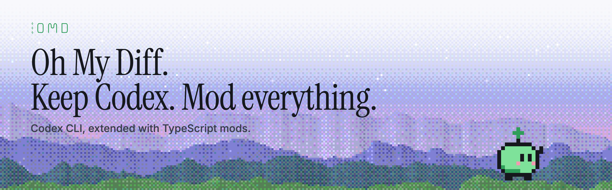

# Oh My Diff



Codex CLI, extended with TypeScript mods.

Oh My Diff (OMD) is a patched [Codex CLI](https://github.com/openai/codex). Mods can change its commands, tools,
context and screen. OMD ships with a small set of mods, and you can write your own. You still start it with
`codex`, and it keeps your Codex settings, sign-in and sessions.

## Quickstart

You need an Apple Silicon Mac with Codex `0.162.x`, Node 24.18+ and Python 3.12+ installed.

1. Install OMD with its mod collection:

   ```sh
   curl --proto '=https' --tlsv1.2 -fsSL https://github.com/dzkchen/oh-my-diff/releases/latest/download/install.sh | sh -s -- --profile full
   ```

2. Start it:

   ```sh
   codex
   ```

3. Type `/mods` to see which mods are on and to turn others on.

For the minimal install, other options, updates and removal, see [Install Oh My Diff](docs/install.md).

## Learn more

- [Mods included with OMD+](docs/collection.md)
- [Install and manage mods](docs/manage-mods.md)
- [Write your first mod](docs/write-a-mod.md)
- [Mod API reference](mods/REFERENCE.md)

## Project status

OMD is a personal developer tool. It hasn't been tested across many machines or workflows, so expect rough edges.
If something breaks, please [open an issue](https://github.com/dzkchen/oh-my-diff/issues/new/choose).

OMD exists because small, everyday workflow improvements get less attention than bigger AI-lab priorities. After
release, the maintainer plans to focus mainly on critical fixes. If you'd like to take over maintenance, get in
touch.

Oh My Diff is not affiliated with or endorsed by OpenAI.

[Changelog](CHANGELOG.md) · [Contributing](CONTRIBUTING.md) · [Security](SECURITY.md) ·
[Code of conduct](CODE_OF_CONDUCT.md) · [MIT License](LICENSE) ([Codex patch notice](NOTICE)) ·
[Third-party notices](THIRD_PARTY_NOTICES.md)
