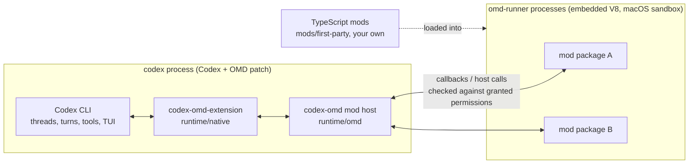

<p align="center">
  
</p>

<h1 align="center">Oh My Diff</h1>

<p align="center">
  <a href="https://github.com/dzkchen/oh-my-diff/releases"></a>
  <a href="https://github.com/dzkchen/oh-my-diff/actions/workflows/nightly.yml"></a>
  <a href="https://github.com/dzkchen/oh-my-diff"></a>
  <a href="LICENSE"></a>
  
  
</p>

<p align="center">
  <strong>Keep Codex. Mod everything.</strong><br/>
  <a href="https://github.com/openai/codex">Codex CLI</a> with a host for TypeScript mods: add commands, tools, context and screens without leaving <code>codex</code>.
</p>

<h3 align="center"><a href="#install"><ins>Install Oh My Diff</ins></a></h3>

<p align="center">
  <a href="https://www.ohmydiff.me">Website</a> ·
  <a href="docs/README.md">Docs</a> ·
  <a href="docs/collection.md">Mods</a> ·
  <a href="CHANGELOG.md">Changelog</a>
</p>

<p align="center">
  
</p>

You still run `codex`, with your settings, sign-in and sessions, and you can go back to plain Codex at any time with
nothing to migrate. OMD is in beta and runs only on Apple Silicon macOS.

## What a mod can do

A mod is a small TypeScript program. It can add a slash command, give the model a new tool, add context to a request,
draw a status line, panel or dialog, or react when the agent runs a tool. Before a mod runs, OMD shows its source,
license and the permissions it asks for, and you can turn any mod off at any time.

This is the mod in the demo above. It blocks force-pushes and adds a `/standup` command:

```ts
import type { ModAPI } from '@oh-my-diff/mod-api';

export default function activate(api: ModAPI) {
  api.intercept('tool', { match: { tool: 'exec_command', arguments: { cmd: /\bgit\s+push\b.*\s(--force|-f)\b/ } } },
    () => ({ deny: 'Force-pushing is off in this repo. Push to a new branch instead.' }));

  api.command('standup', () => ({ submit: 'From git log since yesterday, write my standup as three short bullets.' }),
    { description: 'Ask the agent for a standup from recent commits' });
}
```

A `mod.json` next to it names the mod and asks for the `interception` and `commands` capabilities. The full example
is in [`mods/examples/repo_rules`](mods/examples/repo_rules), and the [agent mod guide](docs/AGENT_MOD_GUIDE.md) lets
Codex write one for you.

[How OMD works](docs/how-omd-works.md) · [Trust and permissions](docs/trust-and-permissions.md) ·
[Write your first mod](docs/mod-authors/first-mod.md)

## Included mods

OMD+ turns these on:

| Mod | What it does |
| --- | --- |
| [Tool lines](mods/first-party/omd_tool_lines/README.md) | One line per tool call, with adjacent shell commands grouped; open a row for the full output |
| [Status line](mods/first-party/omd_statusline/README.md) | Model, context, usage limits, cost, Git branch and CI status under the prompt; `/statusline` edits it |
| [Auto-continue](mods/first-party/omd_auto_continue/README.md) | An unanswered approval or question no longer stalls the turn |
| [Mods](mods/first-party/omd_mods/README.md) | The `/mods` screen: turn mods on or off, change their settings, install new ones |
| [Update](mods/first-party/omd_update/README.md) | Update notices, `/update`, and signed mod fixes between releases |

OMD+ also installs these for you to turn on in `/mods`:

| Mod | What it does |
| --- | --- |
| [Observation mask](mods/first-party/omd_observation_mask/README.md) | Hides old, large tool outputs so long sessions stay cheap; the model can recall any of them |
| [Usage](mods/first-party/omd_usage/README.md) | Context, cache, cost and quota for each request (Alt+a) |
| [Privacy](mods/first-party/omd_privacy/README.md) | Keeps secrets and personal data you choose out of what's sent to the model |
| [Monitor](mods/first-party/omd_monitor/README.md) | Watches a command, file or GitHub run and messages the agent once it finishes, so it doesn't poll |
| [Frecency](mods/first-party/omd_frecency/README.md) | Ranks `@` file mentions by fuzzy match and how often you use them |
| [Tool fix](mods/first-party/omd_tool_fix/README.md) | Repairs clearly malformed tool arguments before they fail |

Experimental mods add other providers, a workspace dock, [`/undo`](mods/first-party/omd_checkpoint/README.md) and
language-server feedback. The [included mods](docs/collection.md) page lists every one and says which are on by
default and which are experimental.

In a [pilot benchmark](docs/benchmarks/harness-mods.md) of 43 tasks, four of the experimental mods cut Codex's cost
by an estimated 25% (95% CI 19% to 31%) with no measurable change in pass rate. It was one model and one run, so
read it as a direction, not a guarantee.

## Works with

<p>
  <a href="https://github.com/openai/codex"><kbd>Codex CLI</kbd></a> &nbsp;
  <a href="docs/use-other-providers.md#use-claude"><kbd>Claude (experimental)</kbd></a> &nbsp;
  <a href="docs/use-other-providers.md#use-cursor"><kbd>Cursor (experimental)</kbd></a> &nbsp;
  <a href="docs/use-other-providers.md#use-an-api-key-or-another-provider"><kbd>OpenAI and Anthropic API keys (experimental)</kbd></a> &nbsp;
  <a href="docs/use-with-t3-code.md"><kbd>T3 Code</kbd></a> &nbsp;
  <kbd>+ any app that runs <code>codex app-server</code></kbd>
</p>

## Install

You need an Apple Silicon Mac, the Codex version the [latest release](https://github.com/dzkchen/oh-my-diff/releases/latest)
builds on, and Python 3.12 or later. The installer prints the command that installs the right Codex if yours differs.
The [install guide](docs/install.md) lists every requirement.

### OMD+ (recommended)

The mod host plus the [included mods](docs/collection.md), with more on the way.

```sh
curl --proto '=https' --tlsv1.2 -fsSL https://github.com/dzkchen/oh-my-diff/releases/latest/download/install.sh | sh -s -- --profile full
```

### OMD Core

Only the mod host: the `/mods` screen, update notices and the OMD logo. Codex otherwise looks and behaves as it
always has. Choose it to add only mods you pick yourself, or to write your own.

```sh
curl --proto '=https' --tlsv1.2 -fsSL https://github.com/dzkchen/oh-my-diff/releases/latest/download/install.sh | sh -s -- --profile platform
```

You can switch later by running the other command.

### First run

```sh
codex
```

Codex starts and shows the OMD logo. Type `/mods` to see which mods are on and to turn others on or off. Outside
`codex`, run `omd` for a short summary of the commands that install, update and manage mods. If `codex` still starts
plain Codex, see [troubleshooting](docs/troubleshooting.md).

## Status

OMD is in beta and under active development, so expect bugs and rough edges. Mod API `1.0.0` is stable, and the parts
marked experimental can change ([support policy](docs/support.md)). Many of the mods I'm developing are experimental
and still have bugs to fix: open a PR if you're feeling up to it!

## Community and support

- **Missing a capability?** The API is young: [request it](https://github.com/dzkchen/oh-my-diff/issues/new?template=mod-api.yml). New features are best written as mods.
- **Bugs and docs problems:** [open an issue](https://github.com/dzkchen/oh-my-diff/issues/new/choose), or see [troubleshooting](docs/troubleshooting.md) first.
- **Security:** [report it privately](SECURITY.md), not in a public issue.
- **Core contributor:** open an issue and say so.
- **Show support:** [star](https://github.com/dzkchen/oh-my-diff) the repo to follow along.

## Developing

See [CONTRIBUTING.md](CONTRIBUTING.md) to run OMD locally or send a change, the [mod API reference](mods/reference/README.md)
for the full API, and the [agent mod guide](docs/AGENT_MOD_GUIDE.md) for coding agents writing mods.

OMD is upstream Codex plus [one patch](runtime/patches) pinned to a single Codex release. The patch adds a mod host
that has no features of its own; every feature is a TypeScript mod running in its own sandboxed runner process.



[How OMD works](docs/how-omd-works.md) explains the design and
[contributing to the patched runtime](docs/contributing/runtime.md) covers changing the Rust.

<a href="https://github.com/dzkchen/oh-my-diff/graphs/contributors">
  
</a>

## License

Oh My Diff is free and open source under the [MIT License](LICENSE) ([Codex patch notice](NOTICE),
[third-party notices](THIRD_PARTY_NOTICES.md)). It is not affiliated with or endorsed by OpenAI.
