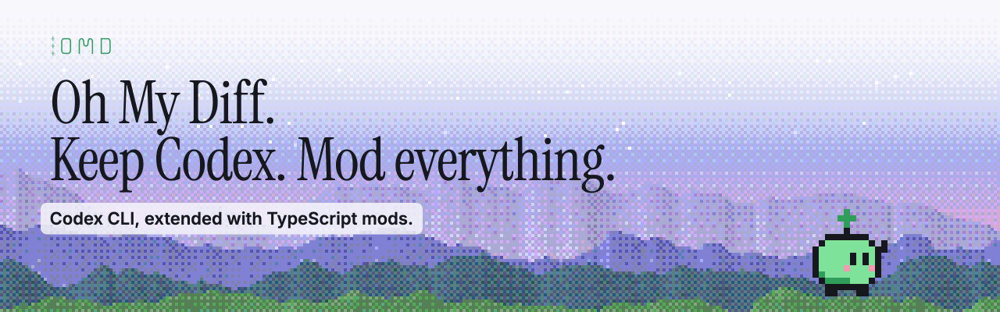

<p align="center">
  
</p>

<h1 align="center">Oh My Diff</h1>

<p align="center">
  <a href="https://github.com/dzkchen/oh-my-diff/releases"></a>
  <a href="https://github.com/dzkchen/oh-my-diff/actions/workflows/nightly.yml"></a>
  <a href="LICENSE"></a>
  
</p>

<p align="center"><b>Codex CLI, extended with TypeScript mods.</b></p>

<p align="center">
  <a href="https://www.ohmydiff.me">Website</a> ·
  <a href="docs/install.md">Install</a> ·
  <a href="docs/collection.md">Included mods</a> ·
  <a href="docs/write-a-mod.md">Write a mod</a> ·
  <a href="CHANGELOG.md">Changelog</a>
</p>

Oh My Diff (OMD) is [Codex CLI](https://github.com/openai/codex) with a host for TypeScript mods: new commands,
tools, context and screens. You still run `codex`, with your settings, sign-in and sessions.

## Install

Needs an Apple Silicon Mac, Codex `0.164.x` and Python 3.12+ ([details](docs/install.md#before-you-begin)).

There are two installs. Pick one; you can switch later by rerunning the command with the other profile.

**OMD+ (recommended for most people)** is OMD plus the [mod collection](docs/collection.md): a status line, compact
tool output, a pinned plan, a model picker and more are on from the start, and the rest are a click away in `/mods`.

```sh
curl --proto '=https' --tlsv1.2 -fsSL https://github.com/dzkchen/oh-my-diff/releases/latest/download/install.sh | sh -s -- --profile full
```

**OMD Core** is only the mod host: the `/mods` screen, update notices and the OMD mark, and Codex otherwise looks and
behaves as it always has. Choose it if you want to add only mods you pick yourself, or to write your own.

```sh
curl --proto '=https' --tlsv1.2 -fsSL https://github.com/dzkchen/oh-my-diff/releases/latest/download/install.sh | sh -s -- --profile platform
```

[Update, switch profile and uninstall](docs/install.md).

## First run

```sh
codex
```

Type `/mods` to see which mods are on and turn others on or off. If `codex` is still plain Codex, add the
`export PATH=...` line the installer printed to the end of `~/.zshrc` and open a new shell. Run `omd` for the
commands you can use from a shell.

## How OMD works

**It is still Codex.** OMD is the Codex CLI you already use, rebuilt with one addition: a place for mods to plug in.
The installer puts a `codex` command in `~/.local/bin` that starts this build instead of the stock one. Your
settings, sign-in, sessions and history in `~/.codex` are the same ones Codex uses, so you can go back to plain
Codex at any time with nothing to migrate.

**Mods are small add-ons.** A mod is a TypeScript package that can add a slash command, give the model a new tool,
add context to a request, draw a status line, a panel or a dialog, or react when the agent runs a tool. OMD+ comes
with a collection of them; you can also install mods from the curated directory, npm, Git or a folder with
`omd install`, or [write your own](docs/write-a-mod.md). Just like Claude Mods!

**You decide what runs.** Installing a mod doesn't turn it on. When you turn one on, OMD shows what it is allowed to
do, such as read files, use the network or run programs, and asks first. Mods run in small sandboxed processes
beside Codex, and if one misbehaves, `omd mods disable ID` switches it off from any shell, even when `codex` won't
start.

**It stays in step with Codex.** Each OMD release is built on one Codex version line, now `0.164.x`, and follows
the latest stable Codex. Turn off automatic Codex updates and update Codex only once `omd update` supports the new
version. Updates are signed and checked before they install, and `omd update rollback` undoes the last one.

## Status

Mod API `1.0.0` is stable; surfaces marked experimental can change ([compatibility](mods/COMPATIBILITY.md)).
The API is still young, so expect new capabilities. If you need a specific one, open an issue or a PR.

I focus mainly on critical fixes and on adding API capabilities for mods. If you'd like to take over
responsibility for the whole project, please get in touch by [opening an issue](https://github.com/dzkchen/oh-my-diff/issues/new/choose).

This project is still in beta and under active development, expect bugs and some small annoyances (just open an issue and I will get on it ASAP :))
If you are looking to become a core contributor, get in touch as well!

## Help and contributing

- Bug or docs problem: [open an issue](https://github.com/dzkchen/oh-my-diff/issues/new/choose).
- Security problem: [report it privately](SECURITY.md), not in a public issue.
- Missing API for a mod: [request it](https://github.com/dzkchen/oh-my-diff/issues/new?template=mod-api.yml).
- Code or docs change: see [CONTRIBUTING.md](CONTRIBUTING.md). New features are best written as mods.

## Docs

- [Install, update, remove](docs/install.md)
- [Included mods](docs/collection.md) and [manage mods](docs/manage-mods.md)
- [Write a mod](docs/write-a-mod.md), [API reference](mods/reference/README.md) and [agent mod guide](docs/AGENT_MOD_GUIDE.md)

Oh My Diff is not affiliated with or endorsed by OpenAI.

[Changelog](CHANGELOG.md) · [Contributing](CONTRIBUTING.md) · [Security](SECURITY.md) ·
[MIT License](LICENSE) ([Codex patch notice](NOTICE)) · [Third-party notices](THIRD_PARTY_NOTICES.md)
