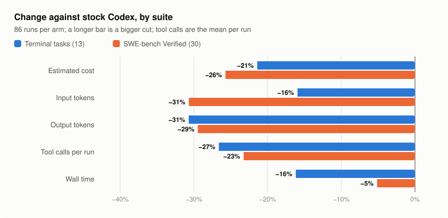
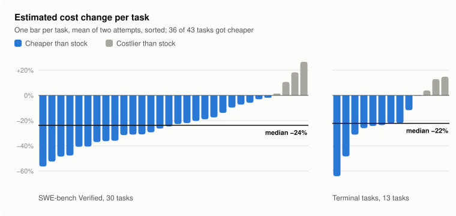
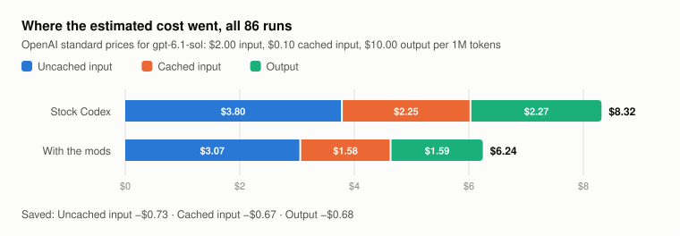

# Four harness mods cut Codex's estimated cost by a quarter on 43 tasks

On 43 coding tasks, two attempts each, Codex with four experimental Oh My Diff (OMD) mods and one plugin component
cost an estimated $6.24 where stock Codex cost $8.32, 25% less. It read 29% fewer input tokens, wrote 30% fewer output
tokens and finished 8% sooner. The pass rate didn't measurably change: terminal tasks passed at 0.962 in both arms,
and SWE-bench tasks went from 0.767 to 0.800, inside a 95% confidence interval that spans zero.

This post covers the setup, two changes that made OMD more expensive before they were fixed, the results, and what
the run can't tell you. Both arms used Codex `0.166.0` on one Apple Silicon Mac on 2026-11-01. It is one run of one
model on 43 tasks, so read the numbers as a direction, not a release measurement. The mods are experimental, and no
install profile includes them.

## The harness is everything around the model

A coding agent's harness is the code between the model and the work: what each request contains, how tool results
come back and when a turn may end. Codex's harness resends every earlier tool output on every request, lets a turn
end without a passing check and reports a syntax error only when something later runs the file. OMD mods can change
each of those points without forking Codex, so I picked techniques with published effects and wrote one mod each.

| Mod | What it changes | Earlier result it builds on |
| --- | --- | --- |
| [`omd_observation_mask`](../../mods/first-party/omd_observation_mask/README.md) | Hides tool outputs older than the newest ten that are at least 1 KiB, in 32 KiB batches so the cached prefix rarely changes. The model reads one back with a recall tool. | Observation masking cut cost by 51% to 57% ([arXiv 2508.21433](https://arxiv.org/abs/2508.21433)) |
| [`omd_verify_stop`](../../mods/first-party/omd_verify_stop/README.md) | When a turn ends after code edits with no passing check, continues it once with a checklist, and once more with a failed check's output. | Agentless gained 5 points from reproduction tests ([arXiv 2407.01489](https://arxiv.org/abs/2407.01489)) |
| [`omd_edit_guard`](../../mods/first-party/omd_edit_guard/README.md) | Syntax-checks each edited file and appends only the errors the edit introduced. | SWE-agent's edit-time linter added 3 points ([arXiv 2405.15793](https://arxiv.org/abs/2405.15793)) |
| [`omd_env_bootstrap`](../../mods/first-party/omd_env_bootstrap/README.md) | Takes one 1.5 KB snapshot of the workspace per thread and keeps it in the cached prompt prefix. | An environment snapshot added 1.7 to 4 points on Terminal-Bench 2 ([arXiv 2603.28052](https://arxiv.org/abs/2603.28052)) |
| [`omd-output-budget`](../../plugins/bundled/oh-my-diff/plugins/omd-output-budget/README.md) component | Replaces a large tool result with an excerpt: the head, the tail, error lines and, for a code file, an outline with line numbers. | |

## Setup

The task set had 30 tasks from SWE-bench Verified (21 Django, 5 SymPy, 2 Sphinx, 1 pytest, 1 seaborn) and 13
terminal tasks I wrote for OMD, such as a race-condition fix, a git bisect and a CSV-to-SQLite import. The terminal
tasks are in the style of Terminal-Bench but aren't from it. I left out the astropy, matplotlib, scikit-learn and
xarray repositories and Django before 3.0, then dropped six Sphinx tasks whose reference patch failed on local arm64
images.

| | Stock arm | Mods arm |
| --- | --- | --- |
| Codex | Homebrew `0.166.0` | OMD `1.2.0` built on Codex `0.166.0` |
| Mods | none | the four mods and the output-budget component |
| Model | gpt-6.1-sol, medium effort | gpt-6.1-sol, medium effort |
| Runner | `codex exec`, three runs at a time | `codex exec`, three runs at a time |
| Runs | 43 tasks × 2 attempts = 86 | 86 |

Both arms used the same sandbox: the workspace was writable, `.git` included, and the network was off. Each SWE-bench
attempt was scored by the SWE-bench 4.1.0 harness and each terminal task by its own check script. Cost is estimated
from token counts at OpenAI's standard prices for gpt-6.1-sol: $2.00 per million input tokens, $0.10 per million
cached input tokens and $10.00 per million output tokens. The runs themselves used a ChatGPT subscription. The
confidence interval is a bootstrap over tasks.

## Two mods made the first round more expensive

I tuned on 23 of the tasks, one attempt each, before the final run. The first round cut input tokens by 18% but
cost by only 5%, because input that isn't served from the provider's prompt cache costs 20 times as much as input
that is.

The first request of 18 of the 23 runs had no cached tokens at all. Stock Codex had none of those in 111 runs. Every
Codex user sends the same tool list and system prompt, about 12K tokens, so the provider almost always has that prefix
cached. Two OMD mods changed the tool list. `omd_plan_anchor` turned on Codex's `update_plan` tool, and
`omd_plan_removal`, which OMD+ turned on at the time, removed `request_user_input`. Either change gave every thread a
prefix nobody else had sent. I turned both off in the mods arm and checked that the first two items of its first
request were  the same as stock's.

`omd_verify_stop` had a different problem. SWE-bench checkouts have no installed dependencies and no network, so a test
often couldn't run at all. The mod still asked the agent to verify, and three tasks took about twice as many tool calls
with no gain. I changed it so that a failed check reporting a missing module, a missing command or a network error marks
the turn as blocked, and the mod doesn't continue it. The second round cut cost by 21% and passed all 23 tasks.

## Results

| | Stock Codex | With the mods | Change |
| --- | ---: | ---: | ---: |
| Estimated cost | $8.32 | $6.24 | −25% |
| Input tokens | 24.4M | 17.3M | −29% |
| Output tokens | 227K | 159K | −30% |
| Wall time | 5,614 s | 5,177 s | −8% |
| Terminal pass@1 | 0.962 | 0.962 | no change |
| SWE-bench pass@1 | 0.767 | 0.800 | +0.033 (95% CI −0.067 to +0.133) |

Token counts, cost and wall time are totals over each arm's 86 runs.

The two suites moved in the same direction on every measure. The agent made fewer tool calls in both: 4.3 instead of
5.9 per terminal run and 11.2 instead of 14.6 per SWE-bench run. Wall time fell less than cost in both suites, and
least on SWE-bench.

The saving wasn't a few outliers. 36 of the 43 tasks got cheaper, and the median task saved 24% on SWE-bench and 22%
on the terminal tasks. Seven tasks cost more, the most `django__django-16145` at +27%.

On SWE-bench, the mods arm solved three tasks at least once that stock Codex failed in both attempts (`django-10973`,
`django-14376` and `django-14608`) and failed both attempts of one that stock solved twice (`django-11400`). With 30
tasks, that difference is inside the noise.

The $2.08 saved came in almost equal parts from uncached input, cached input and output. The cache hit rate barely
moved, from 0.896 to 0.892 on terminal tasks and from 0.926 to 0.914 on SWE-bench, so the mods arm sent less without
breaking the cache. Reasoning tokens fell the most, from 40.6K to 15.7K, or 61%.

## Which mod saved what is unknown

I ran the mods as one set, with no ablation, so the result belongs to the set. The traces show which mods acted.
`omd_verify_stop` and the output-budget component acted often. `omd_observation_mask`, `omd_edit_guard` and
`omd_plan_anchor` almost never did: the runs were short, few outputs were large, and edits rarely broke syntax. The
fewer tool calls are consistent with `omd_env_bootstrap` answering the first questions an agent asks about a
workspace, but I didn't measure that.

The traces also showed what no mod reached. About 5% of requests in both arms lost the provider's cache down to the
shared 12K-token prefix in the middle of a run. Those requests came to about 21% of cost, and a mod can't control the
provider's cache.

## What changed after the run

Three findings from the traces changed code after the final run, and none of them was measured here:

- 196 of the 290 edits in the benchmark were shell commands writing files, which `omd_edit_guard` didn't see. It
  also checks files a shell command changed.
- Another experimental mod, [`omd_loop_guard`](../../mods/first-party/omd_loop_guard/README.md), tells the agent when
  the same call keeps returning the same error or output.
- `omd_plan_removal` no longer changes the tool list, and OMD+ installs it turned off, so plan mode works in Codex and
  in apps such as [T3 Code](../use-with-t3-code.md). `omd_plan_anchor` still adds `update_plan` and stays
  experimental.

## What I didn't measure

- Each mod on its own. The next run is an ablation, one mod off at a time, on the same 43 tasks.
- Long tasks. Observation masking and the plan anchor are built for runs with dozens of large outputs, and these runs
  had few.
- Other models and efforts. Every run used gpt-6.1-sol at medium effort.
- Real billing. The cost is an estimate from list prices, and the runs used a subscription.

The benchmark harness isn't published. The whole experiment, tuning included, used 267 runs of a 300-run budget. Will do a better benchmark in the future with all of OMD+ (and with ablation) when I get more money...