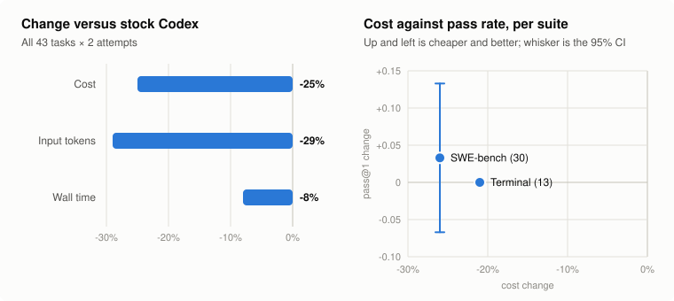

# Harness mods benchmark

A small paired run of stock Codex against Codex with four experimental harness mods and the output-budget component.
It is a rough signal for these mods as a set, not a release measurement.

| | Stock Codex | With the mods | Change |
| --- | --- | --- | --- |
| Cost (estimated) | $4.16 | $3.12 | −25% (terminal −21%, SWE-bench −26%) |
| Input tokens | 12.2M | 8.7M | −29% |
| Wall time | 2,807 s | 2,589 s | −8% |
| Terminal pass@1 | 0.962 | 0.962 | no change |
| SWE-bench pass@1 | 0.767 | 0.800 | +0.033 (95% CI −0.067 to +0.133) |

Pass rates showed no measurable change: the SWE-bench interval spans zero.

## What we ran

- 43 tasks: 30 from SWE-bench Verified and 13 terminal tasks written for OMD (not Terminal-Bench), two attempts each.
- gpt-6.1-sol at medium effort, Codex 0.166 in `codex exec`, with the same tasks and settings in both arms.
- The mods arm turned on `omd_observation_mask`, `omd_verify_stop`, `omd_edit_guard`, `omd_env_bootstrap` and the
  `omd-output-budget` component. It is not the OMD+ install profile: `omd_plan_removal` and `omd_plan_anchor` were off.
- Cost is estimated from token counts and OpenAI's standard list prices.
- The confidence interval is a bootstrap over tasks.

## Caveats

- The result is for the set. There is no per-mod ablation.
- One run of 43 tasks with one model is small; treat the numbers as directional.
- `omd_loop_guard` and `omd_edit_guard`'s shell-edit checks were added after this run and weren't measured.
- The mods are experimental, and no install profile installs them.
- The benchmark harness isn't published.
