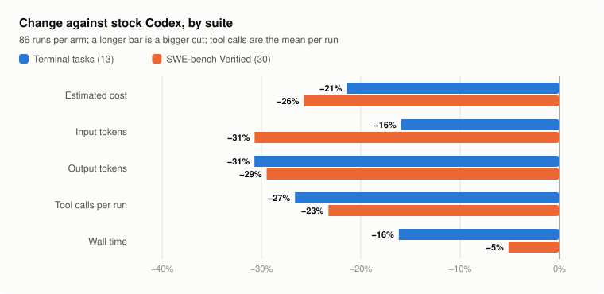
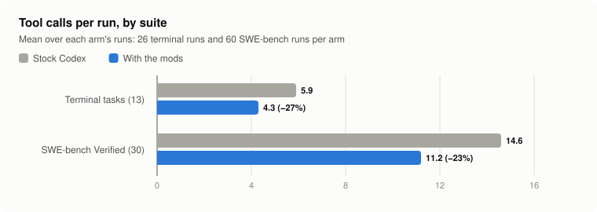
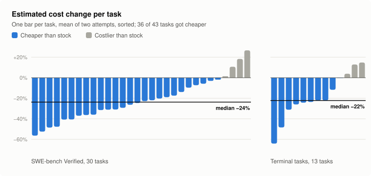
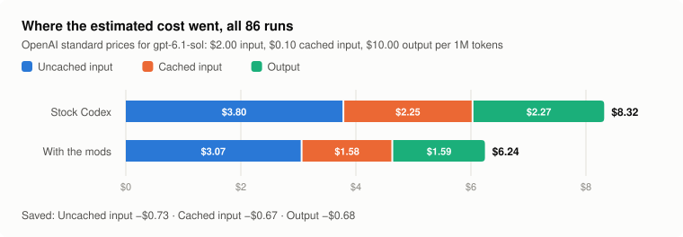
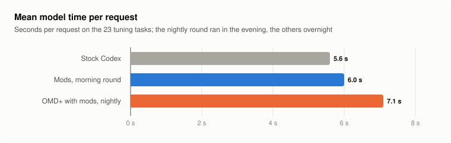

# Four harness mods reduce Codex's estimated cost by a quarter on 43 tasks

On 43 coding tasks, with two attempts each, Codex running four experimental Oh My Diff (OMD) mods and one plugin
component cost an estimated $6.24, compared with $8.32 for stock Codex, a reduction of 25%. It consumed 29% fewer
input tokens, produced 30% fewer output tokens and finished 8% sooner. The pass rate did not change measurably:
terminal tasks passed at 0.962 in both arms, and SWE-bench tasks rose from 0.767 to 0.800, within a 95% confidence
interval that includes zero.

This report covers the setup, two changes that made OMD more expensive until they were corrected, the results and
the limitations of the run. Both arms used Codex `0.166.0` on a single Apple Silicon Mac on 2026-11-01. The results
come from one run of one model on 43 tasks and should be read as an indication of direction, not as a release
measurement. The mods are experimental, and no install profile includes them.

## The harness is everything around the model

A coding agent's harness is the code between the model and the work: what each request contains, how tool results
are returned and when a turn may end. Codex's harness resends every earlier tool output on every request, allows a
turn to end without a passing check and reports a syntax error only when the file is later executed. OMD mods can
change each of these points without forking Codex. I selected techniques with published effects and implemented
each as one mod.

| Mod | What it changes | Prior result it builds on |
| --- | --- | --- |
| [`omd_observation_mask`](../../mods/first-party/omd_observation_mask/README.md) | Hides tool outputs of at least 1 KiB that are older than the newest ten, in 32 KiB batches so that the cached prefix rarely changes. The model can retrieve a hidden output with a recall tool. | Observation masking reduced cost by 51% to 57% ([arXiv 2508.21433](https://arxiv.org/abs/2508.21433)) |
| [`omd_verify_stop`](../../mods/first-party/omd_verify_stop/README.md) | When a turn ends after code edits without a passing check, continues it once with a checklist, and once more with the output of a failed check. | Agentless gained 5 points from reproduction tests ([arXiv 2407.01489](https://arxiv.org/abs/2407.01489)) |
| [`omd_edit_guard`](../../mods/first-party/omd_edit_guard/README.md) | Checks the syntax of each edited file and appends only the errors that the edit introduced. | SWE-agent's edit-time linter added 3 points ([arXiv 2405.15793](https://arxiv.org/abs/2405.15793)) |
| [`omd_env_bootstrap`](../../mods/first-party/omd_env_bootstrap/README.md) | Takes one snapshot of the workspace per thread, of at most 1.5 KB, and keeps it in the cached prompt prefix. | An environment snapshot added 1.7 to 4 points on Terminal-Bench 2 ([arXiv 2603.28052](https://arxiv.org/abs/2603.28052)) |
| [`omd-output-budget`](../../plugins/bundled/oh-my-diff/plugins/omd-output-budget/README.md) component | Replaces a large tool result with an excerpt: the head, the tail, error lines and, for a code file, an outline with line numbers. | |

## Setup

The task set comprised 30 tasks from SWE-bench Verified (21 Django, 5 SymPy, 2 Sphinx, 1 pytest, 1 seaborn) and 13
terminal tasks I wrote for OMD, such as a race-condition fix, a git bisect and a CSV-to-SQLite import. The terminal
tasks follow the style of Terminal-Bench but are not drawn from it. I excluded the astropy, matplotlib, scikit-learn and
xarray repositories and Django versions before 3.0, and dropped six Sphinx tasks whose reference patches failed on
local arm64 images.

| | Stock arm | Mods arm |
| --- | --- | --- |
| Codex | Homebrew `0.166.0` | OMD `1.2.0` built on Codex `0.166.0` |
| Mods | none | the four mods and the output-budget component |
| Model | gpt-6.1-sol, medium effort | gpt-6.1-sol, medium effort |
| Runner | `codex exec`, three runs concurrently | `codex exec`, three runs concurrently |
| Runs | 43 tasks × 2 attempts = 86 | 86 |

Both arms used the same sandbox: the workspace, including `.git`, was writable, and network access was disabled. Each
SWE-bench attempt was scored by the SWE-bench 4.1.0 harness and each terminal task by its own check script. Cost is
estimated from token counts at OpenAI's standard prices for gpt-6.1-sol: $2.00 per million input tokens, $0.10 per
million cached input tokens and $10.00 per million output tokens. The runs themselves were billed to a ChatGPT
subscription. The confidence interval is a bootstrap over tasks.

## Two mods increased cost in the first tuning round

Before the final run, I tuned the mods on 23 of the tasks, with one attempt each. The first round reduced input
tokens by 18% but cost by only 5%, because input that is not served from the provider's prompt cache costs 20 times
as much as input that is.

The first request of 18 of the 23 runs had no cached tokens at all, whereas stock Codex had no such request in 111
runs. Every Codex user sends the same tool list and system prompt, about 12K tokens, so the provider almost always has
that prefix cached. Two OMD mods changed the tool list: `omd_plan_anchor` enabled Codex's `update_plan` tool, and
`omd_plan_removal`, which OMD+ enabled at the time, removed `request_user_input`. Either change gave every thread a
prefix that no other client had sent. I disabled both in the mods arm and confirmed that the first two items of its
first request matched stock's.

In the final run, the first request of both arms carried the same 24 tools and the same 39K characters of tool
schemas. Instructions varied only with the number of skills Codex listed in a run, and the first request was about
15.8K input tokens in both arms, including the task prompt. Tool and instruction lengths are taken from the Codex
session log, which does not record what a mod adds while sending a request. The token counts are reported by the
provider and include everything.

The matching token counts conceal the `omd_env_bootstrap` snapshot rather than indicate that it was absent. The
session log of the mods arm's first request was about 1,500 characters shorter than stock's, mainly because Codex
listed fewer skills in that arm. On the stock runs, the log's length predicts the provider's count to within 34 tokens
(one standard deviation). The same prediction falls short by about 290 tokens on the mods arm's first requests, and
that excess is the text the mod inserted. A later 23-run round, in which the host retained each thread's snapshot,
shows a similar excess (242 tokens) with snapshots averaging 656 bytes.

`omd_verify_stop` had a different problem. SWE-bench checkouts have no installed dependencies and no network access,
so a test often could not run at all. The mod nevertheless asked the agent to verify, and three tasks took about twice
as many tool calls with no improvement. I changed the mod so that a failed check reporting a missing module, a
missing command or a network error marks the turn as blocked, and the mod does not continue it. The second round
reduced cost by 21% and passed all 23 tasks.

## Results

| | Stock Codex | With the mods | Change |
| --- | ---: | ---: | ---: |
| Estimated cost | $8.32 | $6.24 | −25% |
| Input tokens | 24.4M | 17.3M | −29% |
| Output tokens | 227K | 159K | −30% |
| Wall time | 5,614 s | 5,177 s | −8% |
| Terminal pass@1 | 0.962 | 0.962 | no change |
| SWE-bench pass@1 | 0.767 | 0.800 | +0.033 (95% CI −0.067 to +0.133) |

Token counts, cost and wall time are totals over each arm's 86 runs.

Both suites moved in the same direction on every measure. The agent made fewer tool calls in both: 4.3 instead of 5.9
per terminal run and 11.2 instead of 14.6 per SWE-bench run. Wall time fell less than cost in both suites, and least
on SWE-bench.

The saving was not driven by a few outliers. Of the 43 tasks, 36 became cheaper, and the median task saved 24% on
SWE-bench and 22% on the terminal tasks. Seven tasks cost more, the largest increase being `django__django-16145` at
+27%.

On SWE-bench, the mods arm solved at least once three tasks that stock Codex failed in both attempts (`django-10973`,
`django-14376` and `django-14608`), and failed both attempts of one task that stock solved twice (`django-11400`).
With 30 tasks, this difference is within the noise.

The $2.08 saved came in roughly equal parts from uncached input, cached input and output. The cache hit rate barely
changed, from 0.896 to 0.892 on terminal tasks and from 0.926 to 0.914 on SWE-bench, so the mods arm sent less without
breaking the cache. Reasoning tokens fell the most, from 40.6K to 15.7K, a reduction of 61%.

## Attribution to individual mods is unknown

I ran the mods as one set, without ablation, so the result applies to the set as a whole. The traces show which
mods acted. `omd_verify_stop` and the output-budget component acted often. `omd_observation_mask`, `omd_edit_guard`
and `omd_plan_anchor` almost never did: the runs were short, few outputs were large, and edits rarely broke syntax.
The reduction in tool calls is consistent with `omd_env_bootstrap` answering the first questions an agent asks about
a workspace. The snapshot was present in every run's first request, but no run omitted it, so its share of the saving
is unknown.

The traces also revealed costs that no mod addressed. About 5% of requests in both arms lost the provider's cache
down to the shared 12K-token prefix partway through a run. Those requests accounted for about 21% of cost, and the
provider's cache is outside a mod's control.

## Changes after the run

Three findings from the traces led to code changes after the final run. None of them was measured here:

- 196 of the 290 edits in the benchmark were shell commands that wrote files, which `omd_edit_guard` did not observe.
  It now also checks files changed by a shell command.
- Another experimental mod, [`omd_loop_guard`](../../mods/first-party/omd_loop_guard/README.md), notifies the agent
  when the same call repeatedly returns the same error or output.
- `omd_plan_removal` no longer changes the tool list, and OMD+ installs it disabled, so plan mode works in Codex and in
  applications such as [T3 Code](../use-with-t3-code.md). `omd_plan_anchor` still adds `update_plan` and remains
  experimental.

## OMD+ with the mods on the nightly build

After those changes, I ran the 23 tuning tasks once more, with one attempt each, on the OMD nightly of 2026-11-01
(`v1.3.1-nightly.20261101150218`, Codex `0.166.0`). In this round the arm was a full OMD+ install with its default
mods enabled, plus the five mods above, `omd_loop_guard` and the output-budget component. I disabled two OMD+ defaults
that change the tool list, since the nightly predates the fix for them:

- `omd_plan_removal`, which OMD+ now installs disabled.
- [`omd_plan_panel`](../../mods/first-party/omd_plan_panel/README.md), which enables `update_plan` to draw the plan
  above the prompt. This adds `update_plan` to the tool list, so every new OMD+ thread missed the shared 12K-token
  prefix on its first request, the same problem described above. Earlier runs did not show it because they disabled
  the interface mods. OMD+ now installs it disabled.

With both disabled, the first request's tools and system prompt were byte-identical to stock's, and none of the 23
first requests was uncached. The comparison is against the stock runs of the same tasks.

| | Terminal tasks (13) | SWE-bench tasks (10) |
| --- | ---: | ---: |
| Estimated cost | −19% | −22% |
| Input tokens | −18% | −29% |
| Output tokens | −32% | −30% |
| Pass@1 | 0.962 → 1.000 | no change (one task gained, one lost) |
| Wall time | +2% | +31% |

Cost and tokens moved by as much as in the final run; wall time did not. The agent sent 9% fewer requests, but each
took 7.1 seconds of model time on average, against 5.6 seconds for stock and 6.0 seconds for the same mods in the
morning. This round ran in the evening while the others ran overnight, and I ran small local checks alongside it, so I
cannot determine how much of the model-time slowdown is attributable to OMD.

Tool calls took 49 seconds longer in total over the 23 runs (168 against 119), which is OMD's own overhead: the edit
and shell-change checks run inside tool calls. `omd_verify_stop` acted in 4 runs and the output-budget component in 3.
The other mods did not act, and the snapshot was present in all 23 first requests.

## Limitations

- Individual mods. The next run is an ablation, with one mod disabled at a time, on the same 43 tasks.
- Long tasks. Observation masking and the plan anchor are designed for runs with dozens of large outputs, and these
  runs had few.
- Other models and effort levels. Every run used gpt-6.1-sol at medium effort.
- Actual billing. The cost is estimated from list prices, and the runs were billed to a subscription.

The benchmark harness is not published. The full experiment, including tuning and the nightly round, used 290 runs of
a 300-run budget. I plan a larger benchmark covering all of OMD+, with ablation, once further budget is available.
